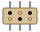
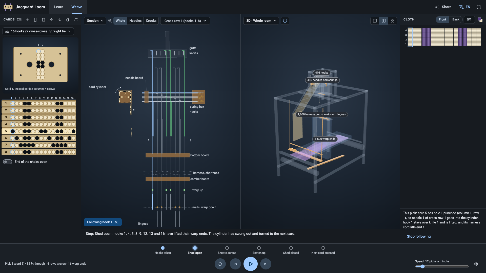
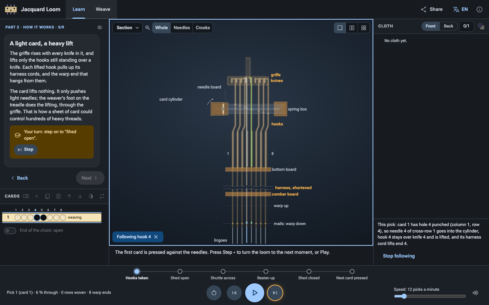
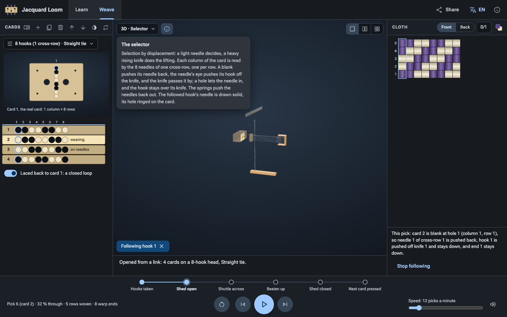
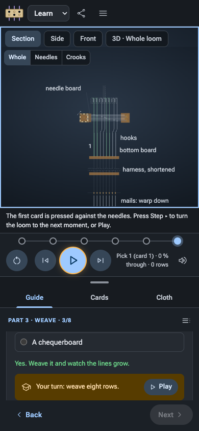

<p align="center">
  
</p>

# Jacquard Loom Simulator

[](https://github.com/wixette/jacquard-loom-simulator/actions/workflows/test.yml)

The loom that wove pictures from a chain of punched cards, in your browser. Punch the cards,
turn the loom, and watch the head choose every thread, pick by pick, in 2D and in 3D, until
the cloth shows the pattern you put in the holes. A tutorial takes you from the loom's story to
weaving a picture by hand.

**[▶ Try it online](https://wixette.github.io/jacquard-loom-simulator/)**, with nothing to
install, on a computer or a phone, in ten languages.



**The route through it:**
[1. Try it](#1-try-it-in-a-minute) →
[2. How a card lifts a thread](#2-how-a-card-lifts-a-thread) →
[3. Learn](#3-learn-the-tutorial) →
[4. Weave](#4-weave-the-loom-is-yours) →
[5. How faithful](#5-how-faithful-is-it) →
[6. For developers](#6-for-developers)

## 1. Try it in a minute

1. Open the simulator, [online](https://wixette.github.io/jacquard-loom-simulator/) or
   [on your own machine](#run-it-locally). The first time, it opens on **Learn**, the
   tutorial, with the whole loom in 3D.
2. Click **Weave** in the top bar. The loom has eight cards on it: an arrow.
3. Click **▶** under the drawings, or press Space.

The head reads the cards one by one. In the section, the knives lift the hooks the holes
chose, the shuttle crosses, the batten beats up, and a row appears in the cloth on the right.
Eight cards later the arrow is woven. Click any cell of the cloth to follow its thread back
through the machine to the hole that lifted it.

## 2. How a card lifts a thread

A figured silk needs hundreds of warp threads to rise on their own, in a different choice for
every row. Before the Jacquard head, a second worker, the draw boy, pulled those cords by hand.
The head, put together by Joseph-Marie Jacquard in Lyon in about 1804–1805 from the ideas of
Bouchon, Falcon and Vaucanson, reads each row's choice from a card instead:

| Part | What it does |
|---|---|
| **Card cylinder** | Presses each card in turn against the ends of the needles, then turns to the next |
| **Needles** | One for each hook. Where the card has a hole, the needle goes in and stays put; where it is blank, the card pushes it back |
| **Hooks** | A pushed needle pushes its hook off its knife; the others stay upright over theirs |
| **Griffe and knives** | Rise with every pick, worked by the weaver's foot on the treadle, and lift only the hooks still over a knife |
| **Harness** | Cords from each hook, through the comber board, to the warp ends it lifts: one in every repeat across the cloth |
| **Shuttle and batten** | The shuttle carries the weft through the gap between the lifted ends and the rest (the shed); the batten beats it into the cloth |

One card weaves one row, each hole drives one hook, and a hole lifts its warp end over the
weft. The card itself lifts nothing: a light needle decides, and the heavy griffe does the work.

**What it is not.** The chain of cards is a program: a fixed list of instructions, read in
order, and repeated when it is laced into a loop. But nothing in it chooses, calculates or
writes anything back, so the loom is not a computer. Its idea, instructions stored as holes,
was borrowed for one: Babbage chose Jacquard's cards for his Analytical Engine.

## 3. Learn: the tutorial



**Learn** runs 21 short steps in three parts, on a loom of its own: your cards in Weave are
never touched.

| Part | Steps |
|---|---|
| **1. The story** | The draw loom; holes before Jacquard (Bouchon 1725, Falcon 1728, Vaucanson 1745); Jacquard puts it together; the woven portrait of 1839. With historical pictures and their credits |
| **2. How it works** | The loom in 3D and its units; the head cut through; a hole or a blank; a light card and a heavy lift; one card, one row; the chain as a program, and as a loop; what it is not |
| **3. Weave** | Punch a card; plain weave; twill; satin, and why stepping by two fails; one hook, many threads; a picture, woven from its bottom row up |

Each step is one card: its text, often a question to predict before weaving, and a task
checked on the loom itself, with a button that works the control it needs. What a step does
not use is greyed. Your place is remembered, and every step has its own link, to send a class
straight to it: `https://wixette.github.io/jacquard-loom-simulator/#v=2&w=learn&step=weave-twill`.

## 4. Weave: the loom is yours

Everything is on one screen: the cards on the left, the drawings in the middle, the cloth on
the right, and the controls along the bottom.

- **The cards.** Click a hole, on the card on the bench or in the chain, to punch it or fill it
  in. The tools over the chain add, duplicate, delete, move and invert cards, load a ready-made
  deck (plain weave, twill, satin, the arrow), and lace the chain into a loop. The chip above
  the cards sets the head, from 8 to 64 hooks, and the tie-up, which repeats the pattern across
  the warp.
- **The drawings.** The menu on each view chooses it: three 2D drawings (the head in section,
  the loom from the side and from the front) or six 3D models (the whole loom, and its five
  units alone, each with a note on the idea it shows). Show one, two side by side, or four.
  Click any part to follow its thread through every view; the thread is traced in words under
  the cloth.
- **The controls.** The six moments of a pick; reset, step back, play or pause, and step; the
  speed, from 6 to 60 picks a minute; and the machine's sound.
- **The cloth.** Its front or its back, the 0/1 bits it was woven from, and the colours of the
  warp and the weft.
- **Share**, in the top bar, copies a link that reopens the loom just as it is, saves a picture
  of the cloth, or prints the cards at true size, to punch and lace by hand.



**The keyboard:** Space plays or pauses, ← and → step, 1 to 4 show the section, the side, the
front or the loom in 3D, F follows what is under the pointer, and Esc stops following.

**On a phone** the drawing sits on top with the controls under it, and the cards, the cloth
and the tutorial share a sheet below it, dragged up or down.



## 5. How faithful is it?

It shows a single-lift Jacquard head on a silk hand loom, of the kind used from about 1810 to
1900: not Jacquard's own first machine, whose size no source gives. The head
is drawn to scale from E. A. Posselt's *The Jacquard Machine Analysed and Explained* (1887),
and the whole loom, with its 400-hook head, is sized after the Science Museum Group's
Spitalfields loom (1914-469). Every dimension, with its source and how sure we are of it, is
in [params/machine.json](params/machine.json).

**Simplifications.** No period source times a treadle-worked head, so the timing of each
moment within a pick is estimated (the order of events is documented). Stepping back unweaves
the last pick exactly, where the real reverse cord re-wove the card before. The cloth is drawn
from the exact weave, without modelling how the yarns bend. One shuttle, one weft colour.

**The history** follows the sources, not the legends: no patent of 1801 (it was for an earlier
machine), no card count for the woven portrait (the famous 24,000 has no source), and Ada
Lovelace's words as she wrote them. The research, including what the sources do not say, is in
[research/REPORT.md](research/REPORT.md).

## 6. For developers

### Run it locally

There is nothing to build: the app is plain HTML, CSS and JavaScript modules. You need
[Git LFS](https://git-lfs.com) for the 3D models, and any static web server:

```
git lfs install
git clone https://github.com/wixette/jacquard-loom-simulator.git
cd jacquard-loom-simulator
python3 -m http.server 8000
```

Then open <http://localhost:8000/>. Opening `index.html` straight from the disk does not work:
browsers do not load JavaScript modules from `file://`. To deploy, copy the repository to any
static host; [the Pages workflow](.github/workflows/pages.yml) publishes `main`.

### Checks

Node 22 or later and [pnpm](https://pnpm.io), for the checks only; the app needs neither.

```
pnpm install
pnpm serve        # http://localhost:8000/, with caching off
pnpm test         # the logic, the translations, the links, the tutorial, the 3D models (Node)
pnpm typecheck    # the JSDoc types, checked strictly; nothing is compiled
pnpm check:refs   # no private references, local paths or broken links
pnpm selftest     # every page's checks in headless Chrome (needs Chrome)
```

CI runs all but `pnpm selftest` on every push, with the REUSE licence check; run
`pnpm selftest` before a release. Add `?selftest` to a page's address to see its checks in the
browser.

### How it is built

| Where | What it is |
|---|---|
| [index.html](index.html), [css/](css/), [js/main.js](js/main.js) | The app: one page, one store |
| [js/sim/](js/sim/) | The machine, as pure logic: the cards, the head, the pick's cycle, the cloth, the links |
| [js/view2d/](js/view2d/), [js/scene/](js/scene/) | The 2D drawings (SVG) and the 3D models (three.js) |
| [js/app/](js/app/) | The frame, the views and panels as components, the tutorial's mode, the keyboard, the sounds |
| [js/teach/](js/teach/) | The tutorial's steps, as data |
| [js/l10n/](js/l10n/) | Every text, in ten languages |
| [params/](params/), [blender/scripts/](blender/scripts/), [assets/](assets/) | The dimensions, the headless Blender scripts that build the models from them, and the models (Git LFS) |
| [dev/](dev/) | Developer pages, one for each stage of the work |
| [research/](research/), [design/](design/), [docs/](docs/) | The research, the design notes and decisions, and how to develop |

Start with [docs/development.md](docs/development.md): the commands, the page options, versions
and releases. The rules the code follows are in [docs/conventions.md](docs/conventions.md), and
the design principles in [docs/ui-design.md](docs/ui-design.md).

### The link format

A link opens the app in a state: a loom (its cards, head, tie-up, moment and views) or a step
of the tutorial. The fields go after `#`, so they never reach the server:

```
https://wixette.github.io/jacquard-loom-simulator/#v=2&h=8&c=x.18-18-18-18-99-5a-3c-18&l=0
```

[Try it](https://wixette.github.io/jacquard-loom-simulator/#v=2&h=8&c=x.18-18-18-18-99-5a-3c-18&l=0):
the arrow, as eight cards in readable hex, on an open chain. The format is a promise to
everyone who has put a link on a worksheet: fields may be added, never renamed or read
differently. Every field is in [design/links.md](design/links.md).

## References

- [Wikipedia: Jacquard machine](https://en.wikipedia.org/wiki/Jacquard_machine)
- [E. A. Posselt, *The Jacquard Machine Analysed and Explained* (1887), at the Internet Archive](https://archive.org/details/jacquardmachinea00poss)
- [A. Barlow, *The History and Principles of Weaving by Hand and by Power* (1878), at the Internet Archive](https://archive.org/details/historyprinciple00barl)
- [Ada Lovelace's notes on Menabrea's *Sketch of the Analytical Engine* (1843): the loom is in Note A](https://www.fourmilab.ch/babbage/sketch.html)
- [Science Museum Group: the Old Spitalfields hand loom, with its Jacquard head (1914-469)](https://collection.sciencemuseumgroup.org.uk/objects/co45152/old-spitalfields-hand-loom)

## Credits

The research relies above all on the public-domain textbooks of E. A. Posselt (1887), A. Barlow
(1878), T. F. Bell (1895), H. W. Nelson (1909) and F. Kohl (1873), and on the Science Museum
Group's catalogue; every source is in [research/sources/bibliography.md](research/sources/bibliography.md).

The tutorial's pictures are public domain or freely licensed, each credited where it is shown.
The machine's sounds were edited from [Pixabay](https://pixabay.com/) sound effects
([audio/SOURCES.md](audio/SOURCES.md)). The interface and its languages follow the sibling
[Stepped Reckoner](https://github.com/wixette/leibniz-stepped-reckoner) simulator. Built with
[three.js](https://threejs.org); set in Roboto Flex, with Material Symbols icons.

## Licence

- **Code:** [Apache-2.0](LICENSE)
- **Original content** (the models, texts, pictures and notes made for this project):
  [CC BY-SA 4.0](LICENSES/CC-BY-SA-4.0.txt)
- **Third-party material** keeps its own licence, declared per path in [REUSE.toml](REUSE.toml)
  and summarised in [docs/licensing.md](docs/licensing.md)
